# Scan to BIM project 
This project is a Scan to BIM pipeline that converts 3D scan data (point cloud data) into BIM objects. The conventional process of converting 3D scan data into BIM models is often inefficient, requiring significant time and manual labor. This project was initiated to automate this process and maximize efficiency. It proposes a flexible pipeline that uses a proprietary JSON-based script called SBDL (Scan to BIM Description Language). This allows users to dynamically define and execute processing steps, aiming to automate the entire workflow — from point cloud noise removal and object classification to geometry extraction and final BIM object generation. This project does not cover every Scan to BIM use case, so you may need to adapt the algorithms in each stage to your data. It includes general Scan to BIM use cases for research purposes; for a specific purpose, customization of the pipeline will be needed. Open source doesn't evolve on its own. If you want to contribute, fork and PR.

# description
The Scan to BIM research project has the following goals.</br>
For reference, you can use the [scan to model program (SMP)](https://github.com/mac999/scan_to_model_pipeline.git), a simple 3D point cloud to model pipeline, and the lightweight 3D point cloud segmentation model [PointEdgeSegNet](https://github.com/mac999/point_edge_seg_net) for large-scale point cloud segmentation.
</br>
1. Dynamic implementation of a 3D point cloud processing pipeline using simple SBDL (Scan to BIM Description Language, JSON format).</br>
2. Classification of outdoor building objects such as walls (facades), roads, etc.</br> 
3. Extraction of geometry information from the classification results.</br>
4. Binding BIM objects with geometry information and property sets.</br>
</br>
<p align="center">
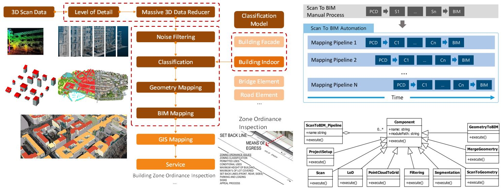</br>
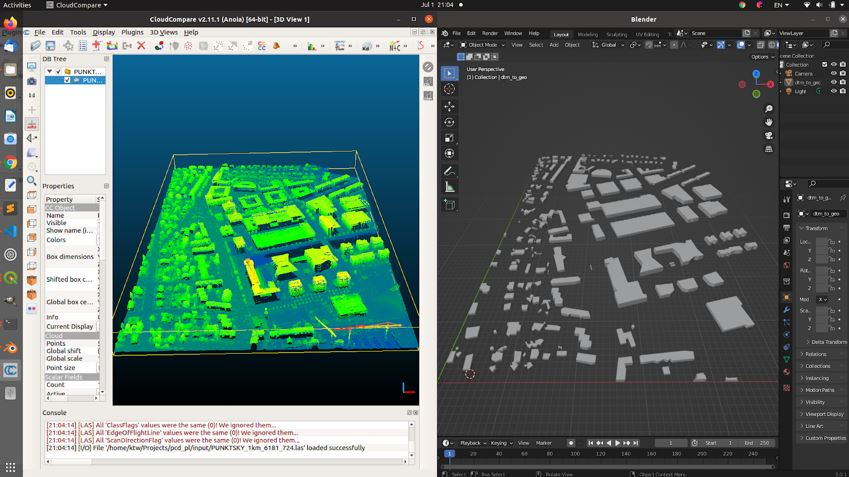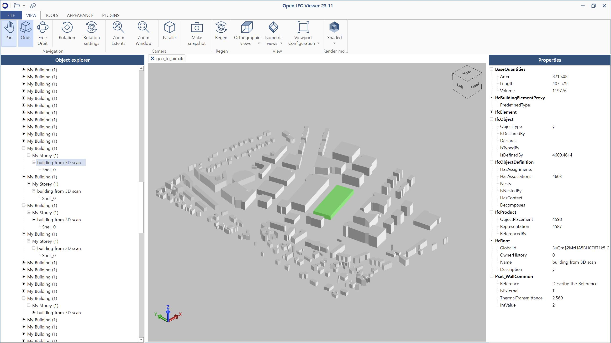</br>
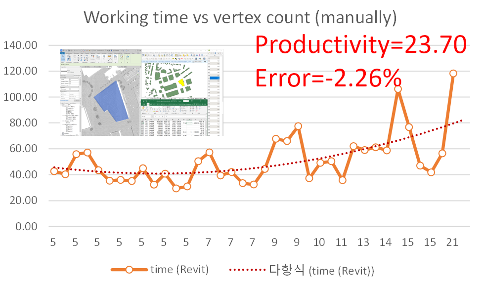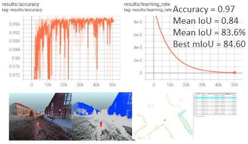</br>
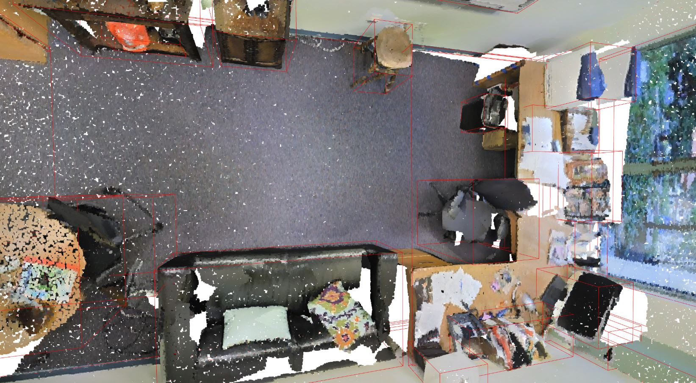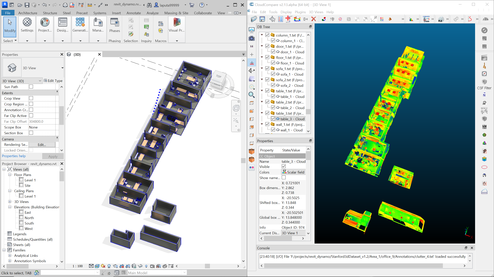</br>
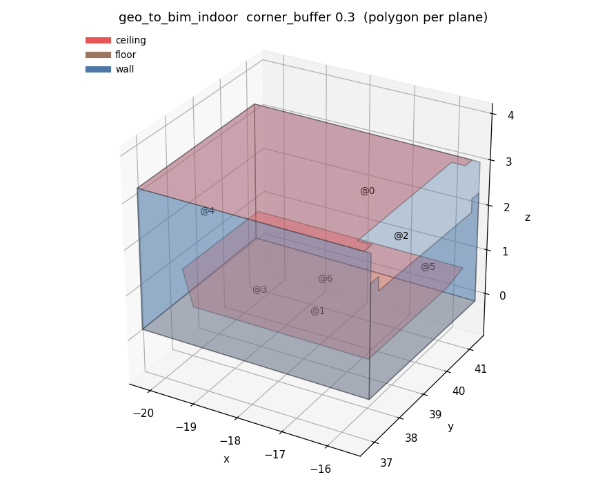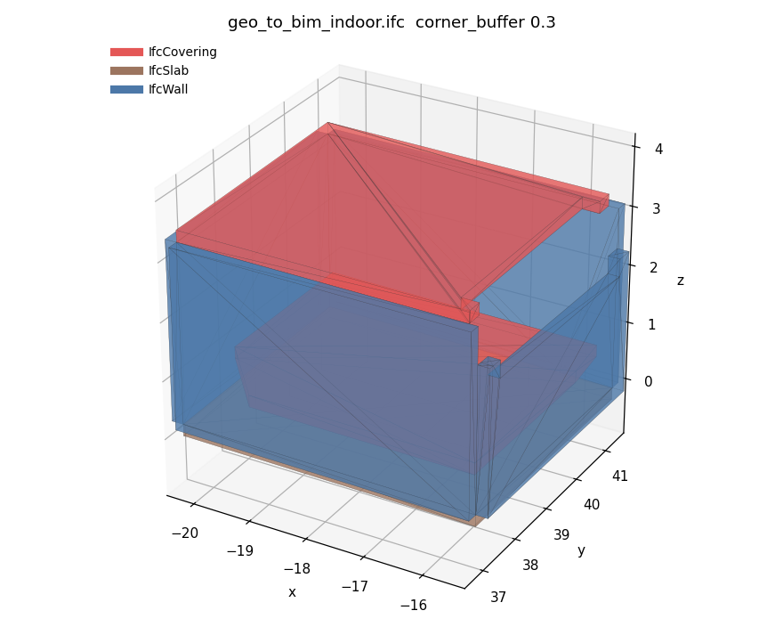</br>
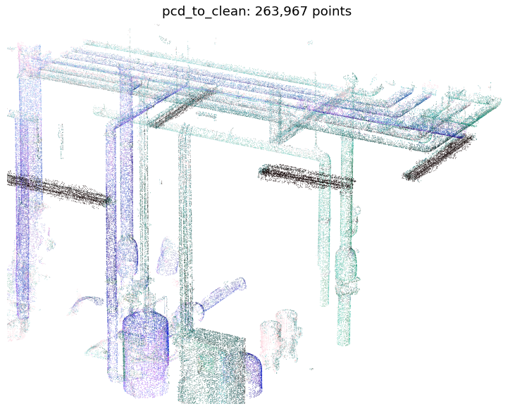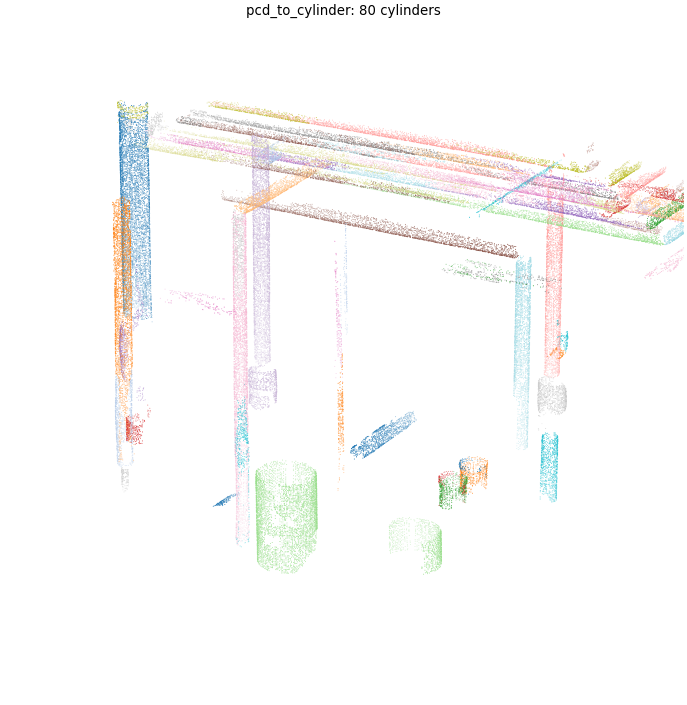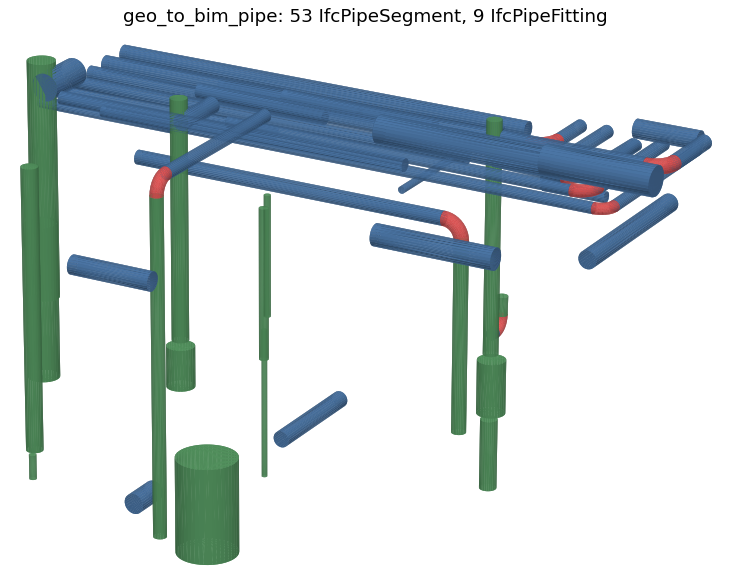
</p>

# setup development environment & packages 
Python 3.11 is supported (3.9–3.11 recommended).
1. install python and pip</br>
https://www.python.org/downloads/</br>
2. install cmake</br>
https://cmake.org/download/</br>
3. install [cuda](https://developer.nvidia.com/cuda-toolkit-archive) and [pytorch](https://pytorch.org/get-started/locally/) (only required for the deep learning segmentation module)</br>
4. install gdal</br>
https://gdal.org/download.html (with conda: `conda install -c conda-forge gdal`)</br>
5. install pdal</br>
https://pdal.io/en/latest/download.html (with conda: `conda install -c conda-forge pdal`)</br>
In a terminal, run the 'pdal' command. On Ubuntu, if you see the error 'libgdal.so.29: cannot open shared object file', create a symbolic link:</br>
sudo ln -s libgdal.so.30 libgdal.so.29</br>
If the prebuilt pdal has issues, download, build and install pdal from the source on GitHub:
https://github.com/PDAL/PDAL</br>
6. install ifcopenshell</br>
https://pypi.org/project/ifcopenshell/ (`pip install ifcopenshell`)</br>
https://docs.ifcopenshell.org/ifcopenshell-python/installation.html</br>
7. build the docker image (optional, for the deep learning segmentation module)</br>
cd docker</br>
cd build_docker_open3d</br>
bash build_docker.sh</br>

# PCL installation
The C++ modules (pcd_density, pcd_to_seg, seg_to_geo) require PCL. Install the packages below or run 'sh [build_pcl.sh](https://github.com/mac999/scan_to_bim_pipeline/blob/main/build_pcl.sh)'.</br>
sudo apt-get install build-essential g++ python3-dev autotools-dev libicu-dev libbz2-dev libboost-all-dev</br>
sudo apt install libeigen3-dev</br>
dpkg -L libeigen3-dev</br>
sudo apt-get install -y libflann-dev</br>
sudo apt-get install libpcap-dev</br>
sudo apt-get install libgl1-mesa-dev</br>
sudo apt install qtbase5-dev qtchooser qt5-qmake qtbase5-dev-tools</br>
sudo apt install clang-format</br>
sudo apt-get install libusb-1.0-0-dev</br>
sudo apt install libvtk9-dev</br></br>
git clone https://github.com/PointCloudLibrary/pcl pcl-trunk</br>
cd pcl-trunk && mkdir build && cd build</br>
cmake -DCMAKE_BUILD_TYPE=RelWithDebInfo ..</br>
make -j2</br>
sudo make -j2 install</br>

For details, refer to</br>
https://github.com/PointCloudLibrary/pcl</br>
https://pcl.readthedocs.io/projects/tutorials/en/latest/compiling_pcl_posix.html</br>

# build & installation
The build uses find_package(PCL) in [CMakeLists.txt](https://github.com/mac999/scan_to_bim_pipeline/blob/main/CMakeLists.txt), so an installed PCL is found automatically. If PCL was built from source without installing, pass its build directory with `-DPCL_DIR=/path/to/pcl/build`. For reference, PCL-1.13 has a memory error (handmade_aligned_free) related to the eigen library (2023/4/10); PCL-1.12 is recommended.</br>
</br>
In a terminal, enter the commands below.</br>
git clone https://github.com/mac999/scan_to_bim_pipeline</br>
cd scan_to_bim_pipeline</br>
pip install -r requirements.txt</br>
mkdir build</br>
cd build</br>
cmake ..</br>
make</br>
</br>
If there are dependency errors with requirements.txt, use requirements_simple.txt.</br>

Or build and run the samples with the scripts in the root folder, build.sh and run_samples.sh on Linux and macOS, build.bat and run_samples.bat on Windows. build installs requirements_simple.txt first with --install and puts the C++ stages in ./bin, using the PCL of the active conda environment (CONDA_PREFIX) or of vcpkg (VCPKG_ROOT, Windows). run_samples runs the indoor_rule pipeline on conference_room1 and the pipe_rule pipeline on kict_mep_zero_en_bdlg_parts, or one of them with indoor or pipe, and prints the IFC file of each. The interpreter is taken from PYTHON, default python.</br>
./build.sh --install</br>
./run_samples.sh</br>
build.bat --install</br>
run_samples.bat pipe</br>
</br>
With conda, [environment.yml](./environment.yml) installs PDAL, GDAL, PCL and the python packages into one environment (tested on Ubuntu 24.04 arm64).</br>
conda env create -f environment.yml</br>
conda activate scan2bim</br>
mkdir build && cd build</br>
cmake .. -DCMAKE_PREFIX_PATH=$CONDA_PREFIX -DQT_HOST_PATH=$CONDA_PREFIX</br>
make</br>

# run
Before running, install requirements_simple.txt (or requirements.txt) including the packages above.</br>
1. Modify /pipeline/config.json considering your input and output folder paths. For reference, the root folder name is scan_to_bim_pipeline, which you downloaded and installed from GitHub.</br>
```
{
    "root_path": "./pipeline/",
    "bin_path": "./",
    "lib_path": "./lib/",
    "data_path": "./input/",
    "data_ext": [".las", ".laz", ".pcd", ".geojson"],
    "pipeline_tag": "scan_to_bim.json"
}
```
2. Download the input sample files and copy them into the ./input folder. Refer to the [sample dataset](https://drive.google.com/drive/folders/1Jb32VkVEuhkKKZ8XVE9E8RLUw2S-VfSd).</br>
3. Run app.py as below.</br>
python ./pipeline/app.py</br>
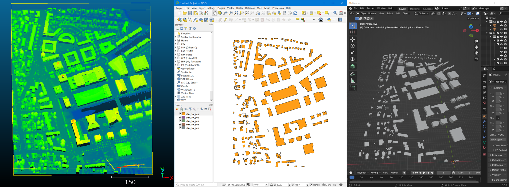</br>
4. Or design a pipeline using SBDL (Scan to BIM Description Language) formatted as JSON like below.</br>
  pipeline.[name]={stage*}</br>
  stage={module_type, parameters}</br>
  parameters={name, value}*</br>
  module_type={python program | docker image | binary executable program}</br>
  * parameters should be defined in the module before usage.</br>
  condition={"in_stage_return", "out_stage_return"}</br></br>

An example Scan to BIM pipeline using SBDL:</br>
pipeline.indoor_obb_extraction = data_to_format > pcd_to_seg > pcd_to_clean > seg_to_geo</br>
pipeline.indoor_obb_extraction(*.las) > *.geojson</br>
</br>
```
{
    "pipeline.indoor_obb_extraction": [
        {
            "type": "data_to_format",
            "active": true,
            "output_type": ".pcd"
        },
        {
            "type": "pcd_to_seg",
            "iteration": "1000", 
            "threshold": "0.1",
            "projection": "true",
            "remove_overlap_distance": "0.10",
            "min_points_ratio": "0.2"
        },
        {
            "type": "pcd_to_clean",
            "voxel_down_size": "0.0",
            "nb_radius_points": "50",
            "nb_radius": "0.1"
        },
        {
            "type":"seg_to_geo",
            "alpha": "0.15"
        }
    ]
}
```
</br>
python ./pipeline/app.py</br>
</br>
app.py resolves the paths in config.json from the repository root, so it runs from any directory. The parameters of each stage are listed in [doc/sbdl.md](./doc/sbdl.md). The conference_room1 sample in ./input has a rule-based indoor pipeline that writes an IFC file:</br>
python ./pipeline/app.py --input_path "./input/conference_room1/*.pcd" --stage indoor_rule</br>
Pipes and elbows of an MEP scan (LAS, LAZ or PCD) are extracted by the pipe_rule pipeline, which writes IfcPipeSegment and IfcPipeFitting elements. Nominal pipe sizes and elbow rules are in [cylinder_to_pipe/pipe_standard.json](./cylinder_to_pipe/pipe_standard.json), the IFC mapping rules in [geo_to_bim_pipe/pipe_mapping_rule.json](./geo_to_bim_pipe/pipe_mapping_rule.json). The sample scan in ./input/kict_mep_zero_en_bdlg_parts is part of the mechanical room of the KICT zero energy building. Shape rules keep shapes that no piping can have out of the result: `pipe_angles` (pcd_to_cylinder) allows only axes at multiples of the fitting angles, e.g. [45, 90], and `min_length_ratio` (cylinder_to_pipe) drops pipes shorter than that many diameters, such as pump bodies. What they reject is listed with its points in the `_log.json` of each stage. The command line of each stage, results on the sample, options and the standard and rule files are described in [doc/pipe.md](./doc/pipe.md).</br>
python ./pipeline/app.py --input_path "./input/kict_mep_zero_en_bdlg_parts/*.laz" --stage pipe_rule</br>
80 cylinders, 53 pipes and 9 elbows are found in under a minute; the IFC file has 53 IfcPipeSegment and 9 IfcPipeFitting.</br>
For large clouds pcd_to_cylinder searches a grid of tiles, each with a margin around it, and joins the pieces of a pipe cut by a tile border before the size and length thresholds are checked again. Set `tiles`, `tile_overlap` (0 picks the margin from `min_length` and `max_radius`) and `tile_workers` in the pcd_to_cylinder stage, or on the command line:</br>
python pcd_to_cylinder/pcd_to_cylinder.py --input ./output/mep/clean --output ./output/mep/cyl --tiles "[2, 2]" --tile_workers 4</br>
On the sample, 2 x 2 tiles in 4 processes take 32 s instead of 37 s and differ from the whole cloud run no more than two runs with other random seeds do. See the large point clouds section of [doc/pipe.md](./doc/pipe.md).</br>

# options and configuration files
Each stage is a program, and the keys of a stage in the SBDL file are its command line options, so a stage can also be run by itself with `--input`, `--output` and the same parameters. Tunable values and standards are kept out of the code:</br>

| file | sets |
|---|---|
| pipeline/config.json | paths, input extensions, SBDL file suffix |
| `<input name>_scan_to_bim.json` | pipelines and stage parameters (SBDL) |
| cylinder_to_pipe/pipe_standard.json | nominal pipe sizes, elbow angles and bend radii |
| geo_to_bim_pipe/pipe_mapping_rule.json | IFC class, type, name and properties of pipes and elbows by rule |

[doc/cli.md](./doc/cli.md) has the options of app.py, how to run one stage, the scripts and the formats of these files. The parameters of every stage are in [doc/sbdl.md](./doc/sbdl.md), and the pipe stages with their standard and rule files in [doc/pipe.md](./doc/pipe.md).</br>

# test
python -m pytest tests</br>
The tests build small synthetic rasters and point clouds. Tests that need PDAL, GDAL, Open3D, ifcopenshell or the C++ build are skipped when those are missing.</br>

# sample dataset
Download a dataset and copy it to the /input folder.</br> 
3D point cloud sample file [download](https://drive.google.com/drive/folders/1Jb32VkVEuhkKKZ8XVE9E8RLUw2S-VfSd)</br>
National LiDAR map [National Map](https://apps.nationalmap.gov/lidar-explorer/#/)</br>
Open Topography [LiDAR map](https://portal.opentopography.org/lidarDataset?opentopoID=OTLAS.052010.26910.1&minX=-122.26765250953395&minY=38.098874920746226&maxX=-122.25515556338722&maxY=38.10795230920854)</br>
Pix4D dataset [Download](https://support.pix4d.com/hc/en-us/articles/360000235126-Example-projects-real-photogrammetry-data#OPF3)</br>
LAS map files [arcgis map link](https://www.arcgis.com/apps/webappviewer/index.html?id=8a7ca254395f424a8bd4c1c8c7a21acb)</br>
LiDAR files [USGS gov](https://www.usgs.gov/faqs/what-lidar-data-and-where-can-i-download-it)</br>
Top 6 Free LiDAR Data Sources [LiDAR files](https://gisgeography.com/top-6-free-lidar-data-sources/)</br>

# architecture
SBDL concept diagram and [UML](./doc/SAD.uml) architecture.</br>
<p align="center">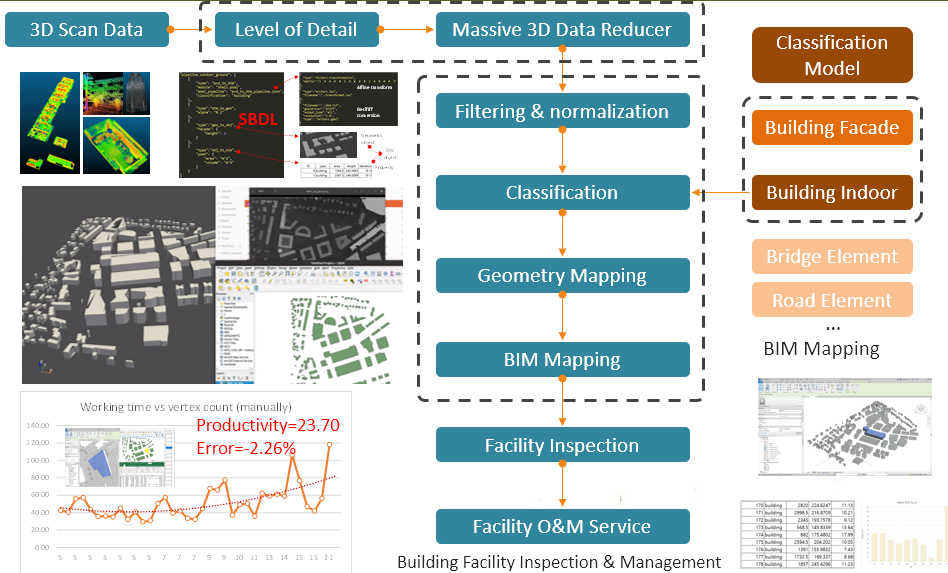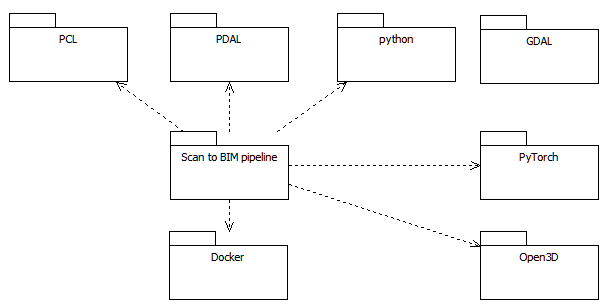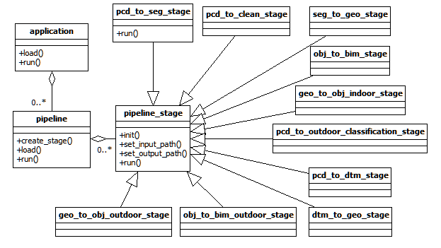</p>

# version history
| version | date | changes |
|---|---|---|
| v0.1 | 2022.11 | Pipeline framework and SBDL. Geometry algorithms for outdoor facade objects, deep learning and docker-based stages. |
| v0.2 | 2023.7 | Docker image support. Pipelines over multiple input files. Refactoring. |
| v0.3 | 2023.8 - 2023.10 | Related tools: [data augmentation](https://github.com/mac999/pcd_augmentation), [LiDAR simulation](https://github.com/mac999/simulate_LiDAR), [scan quality checker](https://github.com/mac999/check_scan_quality). |
| v0.4 | 2023.10 - 2023.12 | Indoor stages: deep learning segmentation with RandLA-Net trained on S3DIS (pcd_to_seg_ml, run in docker), segment to geometry by ML (seg_to_geo_ml), bounding boxes with Revit family mapping (pcd_to_bbox), wall and floor mapping (geo_to_bim_indoor). |
| v0.5 | 2024.2 | pcd_to_dtm and dtm_to_geo fixes. Options active, log_view, height_building_offset, height_ground_offset, max_building_height. |
| v0.6 | 2026.7 | Python 3.11, Shapely 2 and NumPy 1.24 support. CMake uses find_package(PCL). Fixes in elevation sampling, the height axis of object classification and point density. |
| v0.6.1 | 2026.11 | A failed stage stops its pipeline. ifcopenshell 0.8 support. Outdoor IFC keeps map coordinates (IfcMapConversion) and ground elevation. Indoor IFC output (IfcWall, IfcSlab, IfcCovering), with planes joined at shared edges and corners (corner_buffer). Options moved to config.json and stage parameters, see [doc/sbdl.md](./doc/sbdl.md). environment.yml and tests. |
| v0.7 | 2026.11 | Pipe stages after Kang et al. 2020 (Appl. Sci. 10, 7422): RANSAC cylinder extraction (pcd_to_cylinder), straight pipes and elbows with nominal sizes (cylinder_to_pipe), IfcPipeSegment and IfcPipeFitting by mapping rules (geo_to_bim_pipe). Pipe standard and mapping rules are JSON files. pcd_to_clean reads LAS and LAZ. Tiled cylinder search for large clouds. Shape rules on pipe axis angles and length per diameter, stage logs of rejected shapes. MEP sample scan of the KICT zero energy building, see [doc/pipe.md](./doc/pipe.md). |

<p align="center">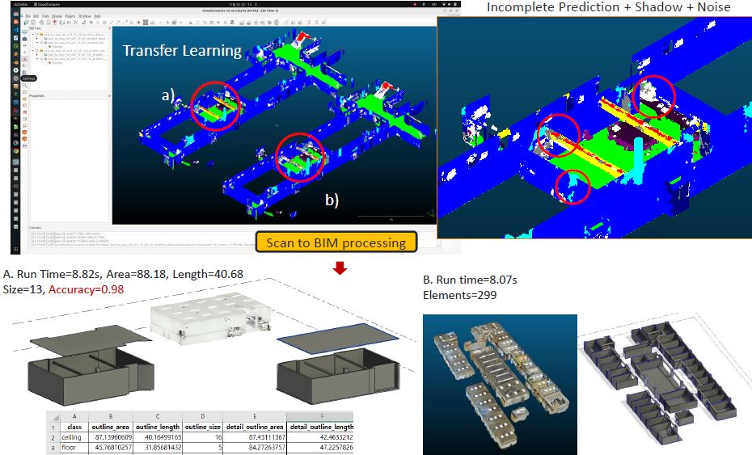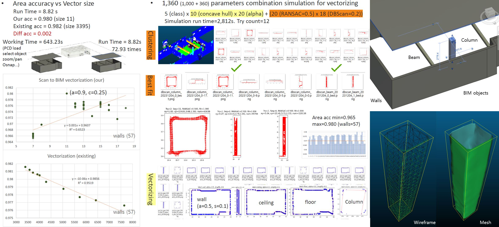</p>

Planned: MLOps for outdoor object training, SBDL authoring with visual flow programming or an LLM, a Revit plugin that builds elements from the pcd_to_bbox family mapping, and a scan data processing app on top of the pipeline.</br>

# license
MIT license.</br></br>
Acknowledgment.</br>
> Scan To BIM Technology Development 3D Urban Building Model Process Automation, 2022</br>
> 3D vision & AI based Indoor object Scan to BIM pipeline for building facility management, 2023</br>
Funded by KICT</br></br>
Organization Roles</br>
> KICT: Scan to BIM pipeline architecture design, algorithm programming, test, code management</br></br>
Special thanks for contributions as below</br>
> IUPUI (Prof. Koo Dan, Prof. Kwonsik Song), UNF (Prof. Jonghoon Kim): use case, code, policy survey</br>
> Purdue University (Prof. Kyubyung Kang): deep learning training, dataset collection, labeling, analysis</br>
> Stony Brook University (Prof. Jongsung Choi): data collection using SLAM, labeling, analysis</br>
</br>
Kang, TW., Patil, S., Kang, K., Koo, D. and Kim, J., 2020. Rule-based scan-to-BIM mapping pipeline in the plumbing system. Applied Sciences, 10(21), p.7422. https://www.mdpi.com/2076-3417/10/21/7422</br>
Kang, TW., 2023, Scan to BIM Mapping Process Description for Building Representation in 3D GIS, Applied Sciences. 13(17), https://www.mdpi.com/2076-3417/13/17/9986
