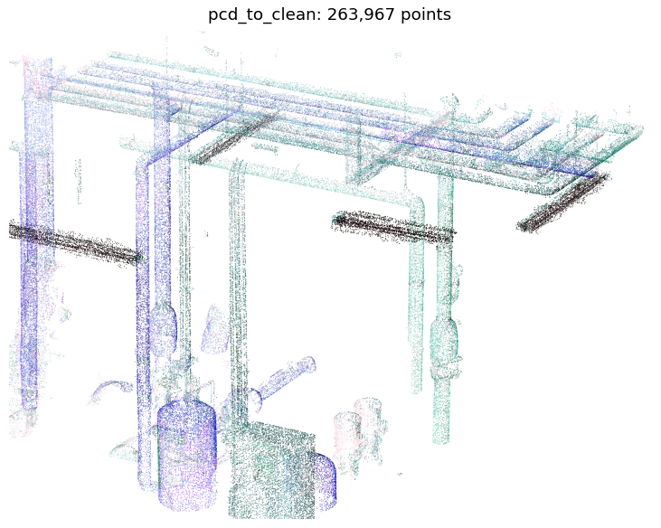
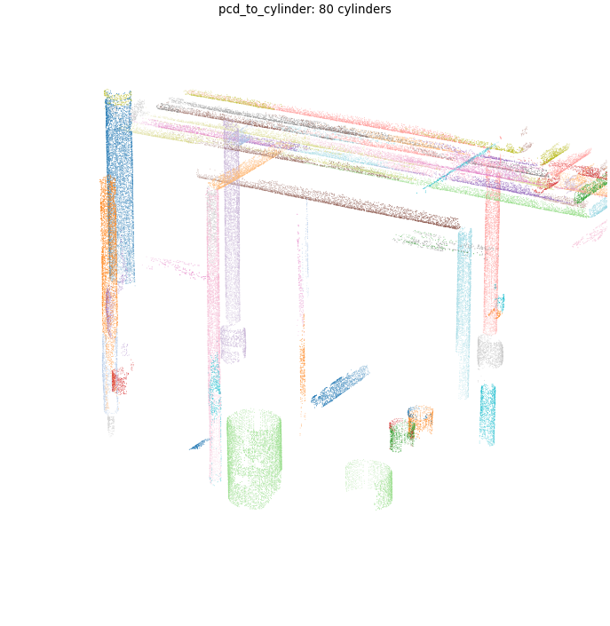
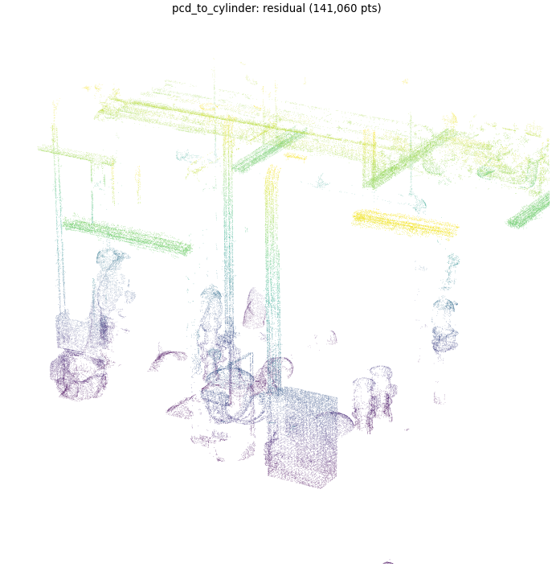
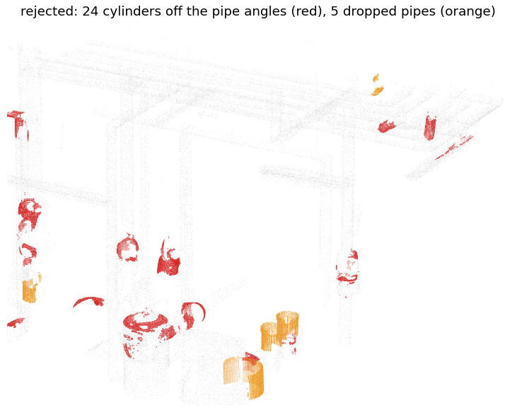
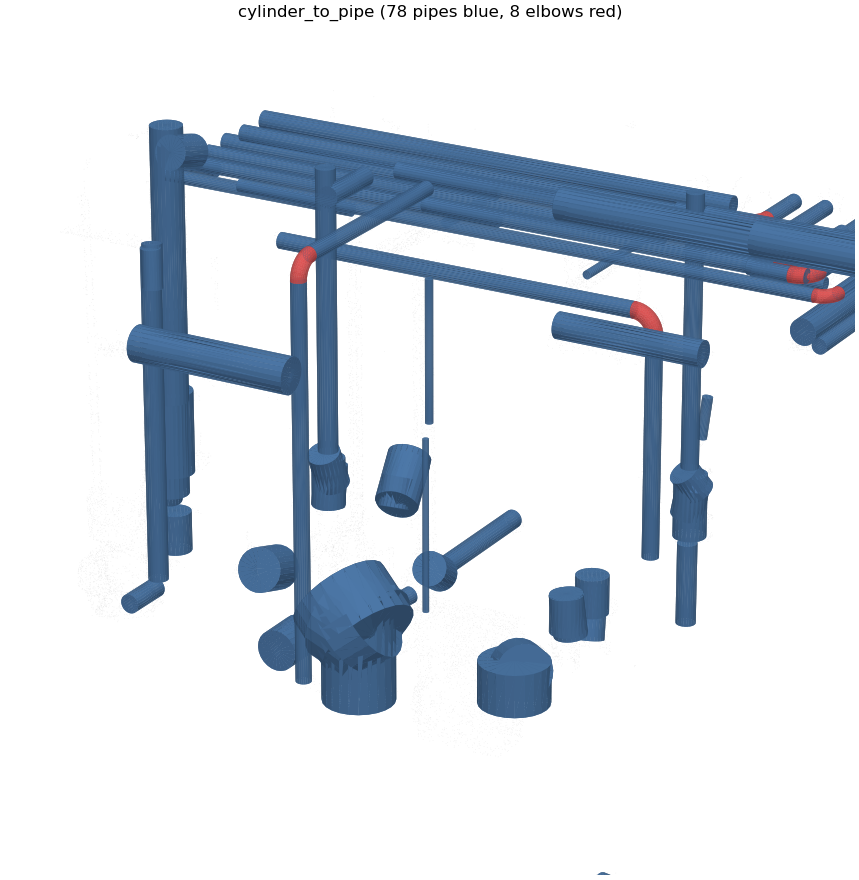
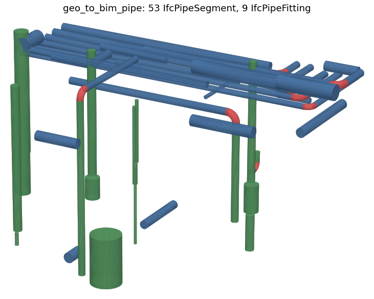
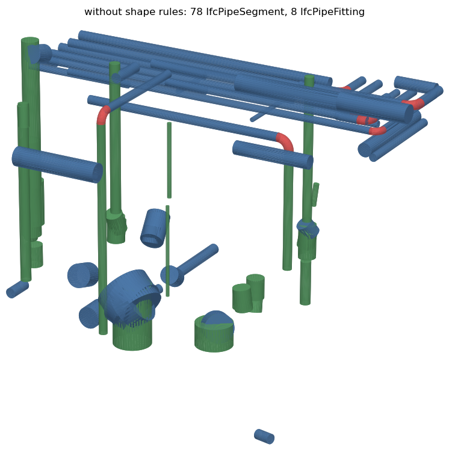
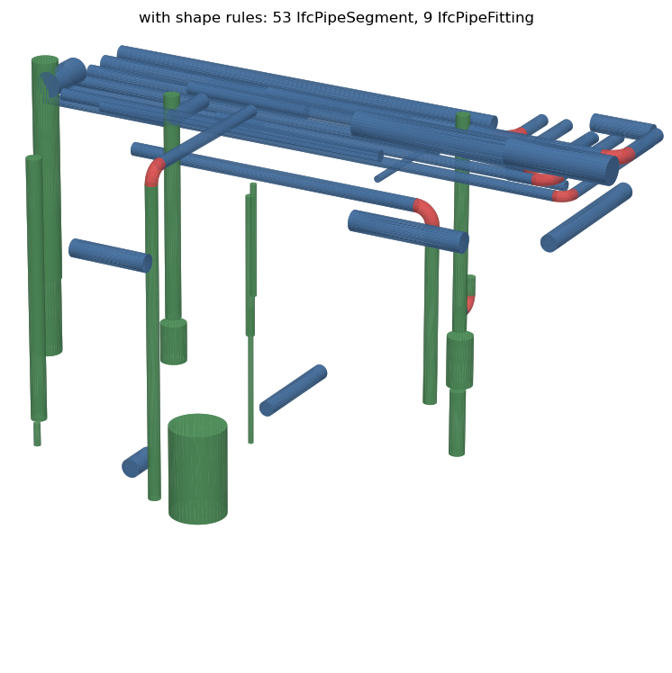

# Pipe stages

The pipe stages turn a scan of MEP piping into IFC pipe segments and elbows. They follow the rule-based plumbing pipeline of Kang et al. 2020 (Applied Sciences 10(21), 7422): cylinders are found with RANSAC, joined into straight pipes and elbows, and mapped to IFC classes by rules.

```
pipeline.pipe_rule = pcd_to_clean > pcd_to_cylinder > cylinder_to_pipe > geo_to_bim_pipe
pipeline.pipe_rule(*.laz | *.las | *.pcd) > *.ifc
```

| stage | input | output |
|---|---|---|
| pcd_to_clean | LAS, LAZ, PCD, PLY | `pcd_to_clean.pcd`, down sampled and without outliers |
| pcd_to_cylinder | point cloud | `_@<n>.pcd` per cylinder, `_residual.pcd`, `_cylinder.json`, `_log.json`, `_rejected_@<n>.pcd` |
| cylinder_to_pipe | `_cylinder.json` | `_pipe.json` (pipes and elbows), `_pipe.ply` (mesh for checking), `_log.json` |
| geo_to_bim_pipe | `_pipe.json` | `.ifc` with IfcPipeSegment and IfcPipeFitting |

Coordinates are taken as meters. Scans in millimeters or feet have to be scaled first, or every length parameter below changed to that unit.

## sample

`input/kict_mep_zero_en_bdlg_parts/kict_mep_zero_en_bdlg_parts.laz` is part of the mechanical room of the KICT zero energy building: a pipe rack, risers, elbows, pumps, an expansion tank and a control panel. 2,016,241 points, about 4.4 x 4.0 x 2.7 m, 2 mm point spacing. Its pipeline is `kict_mep_zero_en_bdlg_parts_scan_to_bim.json` in the same folder.

## command line

Run the whole pipeline from the repository root:

```
python ./pipeline/app.py --input_path "./input/kict_mep_zero_en_bdlg_parts/*.laz" --stage pipe_rule
```

`--input_path` is a glob of the input files. For each file `app.py` reads `<name>_scan_to_bim.json` next to it, or the file given with `--pipeline`. `--stage pipe_rule` runs only the pipelines whose name matches. Results go to `output/<name>/<stage>/`.

Each stage is also a program of its own. `--input` is a path prefix; the stage reads every file that starts with it. `--output` is the prefix of the files it writes. Parameters not given keep their defaults (see [sbdl.md](./sbdl.md)).

```
python pcd_to_clean/pcd_to_clean.py --input ./input/kict_mep_zero_en_bdlg_parts/kict_mep_zero_en_bdlg_parts.laz --output ./output/mep/clean --voxel_down_size 0.01 --stat_neighbors 20 --stat_std_ratio 2.0 --nb_radius_points 10 --nb_radius 0.03
python pcd_to_cylinder/pcd_to_cylinder.py --input ./output/mep/clean --output ./output/mep/cyl --min_radius 0.01 --max_radius 0.3 --pipe_angles "[45, 90]"
python cylinder_to_pipe/cylinder_to_pipe.py --input ./output/mep/cyl --output ./output/mep/net --pipe_standard cylinder_to_pipe/pipe_standard.json --min_length_ratio 1.5
python geo_to_bim_pipe/geo_to_bim_pipe.py --input ./output/mep/net --output ./output/mep/mep --mapping_rule geo_to_bim_pipe/pipe_mapping_rule.json
```

The messages of a run on the sample (the per cylinder lines shortened):

```
263967 points
cylinder 0: r=0.098 length=1.65 points=9556 coverage=0.89
cylinder 1: r=0.022 length=0.80 points=287 coverage=0.28
...
80 cylinders, 24 rejected, 141060 points left, 37.3 s
80 cylinders merged into 53 pipes, 9 elbows, 48 pipes with a nominal size, 5 dropped
62 elements saved to .../geo_to_bim_pipe/geo_to_bim_pipe.ifc: {'IfcPipeSegment': 53, 'IfcPipeFitting': 9}
```

## results on the sample

The whole run takes under a minute on a 20 core ARM machine, most of it in pcd_to_cylinder. The sample pipeline uses the shape rules below (`pipe_angles` [45, 90], `min_length_ratio` 1.5).

<p align="center">
</br>
</br>

</p>

1. pcd_to_clean. A 1 cm voxel grid and the outlier filters leave 263,967 points.
2. pcd_to_cylinder. 80 cylinders, one color each. Pipes of the rack that are scanned from one side only are found, because a cylinder needs an unbroken arc of a quarter of the circle, not the full circle.
3. The residual. 141,060 points are not on any cylinder: pumps, valves, flanges, the panel, cable trays and the elbows, whose bends are not cylinders. The flat trays above the rack stay here as they should.
4. Rejected. 24 cylinders whose axes no fitting can make (red) are rejected in pcd_to_cylinder, mostly on the curved casings of pumps and valves. 5 pipes are dropped in cylinder_to_pipe (orange): 4 short, thick cylinders of pump bodies and 1 piece inside a bend.
5. cylinder_to_pipe. 80 cylinders are merged into 53 straight pipes (blue), and 9 elbows (red) are made where two pipe ends meet at 90 degrees. 48 pipes got a nominal size, most of them 80A, 90A, 65A and 100A. Each elbow is tangent to both pipes with no gap.
6. geo_to_bim_pipe. The IFC file opened again with ifcopenshell: 53 IfcPipeSegment (pipes blue, risers green) and 9 IfcPipeFitting BEND (red). All 62 shapes are valid solids.

What it does not do yet:

- The expansion tank is upright and longer than its diameter, so the shape rules keep it as a pipe. A mapping rule on `diameter` can map it to another class.
- Where pipes turn twice in a short distance the pieces between the turns are too short to find, so those elbows are missing.
- The measured diameter of an insulated pipe is the insulation, so its nominal size is that of a larger pipe. Use the nominal sizes as a guide.
- Tees, reducers, valves and flanges are not modeled. Their points are in the residual.

## options

All stage parameters are listed in [sbdl.md](./sbdl.md). These are the ones to look at first for a new scan.

| parameter | stage | when to change it |
|---|---|---|
| `voxel_down_size` | pcd_to_clean | 0.005 to 0.01 for pipes. a coarser grid loses the small pipes |
| `normal_radius` | pcd_to_cylinder | a few times the point spacing, and below twice the smallest pipe radius. too large bends the normals of small pipes |
| `min_radius`, `max_radius` | pcd_to_cylinder | the range of pipe radii in the scan. a larger `max_radius` picks up tanks and pump bodies |
| `distance_tolerance` | pcd_to_cylinder | about the scan noise. raise it for SLAM or photogrammetry |
| `min_coverage` | pcd_to_cylinder | lower it for pipes seen from one side only, raise it when false cylinders appear between pipes lying side by side |
| `min_points`, `min_length` | pcd_to_cylinder | lower them to keep short pieces such as the pipe between two elbows |
| `axis_snap_angle` | pcd_to_cylinder | 0 for sloped pipes such as drains |
| `pipe_angles`, `grid_azimuth` | pcd_to_cylinder | the fitting angles of the piping and the direction of the building grid, see shape rules |
| `min_length_ratio` | cylinder_to_pipe | the shortest pipe as a multiple of its diameter, see shape rules |
| `merge_gap` | cylinder_to_pipe | the largest gap along a pipe, such as a valve or a hanger that hides the pipe |
| `pipe_standard` | cylinder_to_pipe | another file for another standard. empty keeps the measured radii |
| `nominal_tolerance` | cylinder_to_pipe | how far a measured radius may be from a nominal size |
| `elbow_reach` | cylinder_to_pipe | how far a pipe end may stop short of the corner. raise it when the bend is long or poorly scanned |
| `mapping_rule` | geo_to_bim_pipe | another rule file for other IFC classes, names or properties |

The SBDL file of the sample sets them like this:

```
{
    "type": "pcd_to_cylinder",
    "normal_radius": 0.03,
    "min_radius": 0.01,
    "max_radius": 0.3,
    "distance_tolerance": 0.005,
    "min_coverage": 0.25,
    "axis_snap_angle": 5.0,
    "pipe_angles": [45, 90]
}
```

## shape rules

RANSAC fits a cylinder to any curved surface, including pump casings, valve bodies and tank heads. Two facts about piping tell most of these apart from pipes.

- A pipe run turns only by the angles of its fittings, usually 90 and 45 degrees, sometimes 30 or 60. So a pipe axis is level or vertical, or at a multiple of a fitting angle from them, and its plan direction is the building grid turned by such a multiple. With `pipe_angles` [45, 90] the axis must lie within `axis_snap_angle` of one of 9 directions (x, y, z, the 4 level diagonals and the 4 diagonals at 45 degrees up); [30, 45, 60, 90] gives 33 directions and [90] only x, y and z. A cylinder on another axis is rejected and its points are left for other cylinders. A cylinder near an allowed direction is snapped to it. `grid_azimuth` turns the grid when the scan is not aligned with x and y. [] (the default) allows any axis as before.
- A pipe is long for its diameter. Pump bodies and motor housings are short and thick. `min_length_ratio` drops pipes shorter than that many diameters, unless an elbow joins them. It is applied after merging, so the short pieces of one long pipe are not lost. 0 (the default) keeps them.

Results on the sample, with pipes on x, y or z and at least 2 diameters long counted as real pipes:

| run | cylinders | pipes | elbows | real pipe length found | other shapes |
|---|---|---|---|---|---|
| no rules, seed 1 | 118 | 85 | 9 | 91 % | 32 |
| no rules, seed 2 | 108 | 79 | 10 | 85 % | 27 |
| rules, seed 0 | 80 | 53 | 9 | 88 % | 7 |
| rules, seed 1 | 68 | 45 | 8 | 87 % | 5 |
| rules, seed 2 | 83 | 56 | 8 | 86 % | 4 |
| rules, 2 x 2 tiles | 78 | 56 | 11 | 92 % | 7 |

The real pipe length is the share of the real pipes of a run without rules (2 x 2 tiles, 59.8 m) found again. The rules remove most of the other shapes and find the real pipes as well as a run without them; the spread is that of RANSAC itself. [90] alone gave a few percent more real pipe length on this room, which has no 45 degree runs.

Each stage writes what it rejected to `<output>_log.json`, so a result can be checked without running it again:

```
pcd_to_cylinder_log.json
{"stage": "pcd_to_cylinder", "input": [...], "parameters": {...}, "points": 263967, "cylinders": 80,
 "rejected": 24, "residual": 141060, "seconds": 37.3,
 "rejected_cylinders": [{"id": 0, "reason": "direction", "elevation": 66.08, "azimuth": 87.71,
                         "file": "pcd_to_cylinder_rejected_@0.pcd", "start": [...], "end": [...], "axis": [...],
                         "radius": 0.099, "length": 0.24, "points": 499, "coverage": 0.56}, ...]}

cylinder_to_pipe_log.json
{"stage": "cylinder_to_pipe", "input": [...], "parameters": {...}, "cylinders": 80, "pipes": 53, "elbows": 9,
 "dropped": 5,
 "dropped_pipes": [{"reason": "length_ratio", "length_ratio": 0.62, "id": 4, "start": [...], "end": [...],
                    "radius": 0.202, "nominal": null, "length": 0.25, "cylinders": [31], ...}, ...]}
```

`elevation` is the angle of the axis from the level plane and `azimuth` its plan direction from the grid, both in degrees. The points of each rejected cylinder are in the `file` next to the log; those of a dropped pipe are in the `_@<n>.pcd` files of its `cylinders`. The reasons are `direction` (pcd_to_cylinder), `elbow_piece`, `short` (below `min_pipe_length`) and `length_ratio` (cylinder_to_pipe). A surface found again from other seeds is listed once.

<p align="center">

</p>

Without rules (left) and with them (right).

## large point clouds

pcd_to_cylinder can split the cloud into a grid of tiles with `tiles` and search them one by one or in parallel (`tile_workers`). The search time of a tile grows with its points times its cylinders, so smaller tiles in parallel finish sooner.

```
python pcd_to_cylinder/pcd_to_cylinder.py --input ./output/mep/clean --output ./output/mep/cyl --tiles "[2, 2]" --tile_workers 4
```

or in the SBDL file:

```
{"type": "pcd_to_cylinder", "tiles": [2, 2], "tile_overlap": 0, "tile_workers": 4}
```

Cutting a pipe at a tile border leaves two pieces that may each fall below `min_points` or `min_length`, or below `min_coverage` when the border runs along the pipe. Three things keep the result close to that of the whole cloud.

1. Each tile is searched with a margin (halo) around it, as in the chunk buffers of lidR and the buffered splitters of PDAL. With a margin of at least `min_length` and the pipe diameter, a cylinder that crosses into a tile is seen there with at least the margin of its length and its whole cross section, so it passes the same thresholds as in the whole cloud. `tile_overlap` 0 picks max(`min_length`, 2 x `max_radius`) + `max_gap`.
2. A cylinder found in two tiles, or in two pieces, is joined into one: same axis and radius, overlapping or with a gap below `max_gap`. The joined cylinder is refitted on all its points.
3. The thresholds are checked again on the joined cylinders, and a point found by two cylinders stays with the larger one. `_cylinder.json` looks the same as without tiles, so the next stages do not change.

On the sample with 2 x 2 tiles (margin 0.65 m) and the shape rules:

| run | cylinders | pipes | elbows | time |
|---|---|---|---|---|
| whole cloud, seed 0 | 80 | 53 | 9 | 37 s |
| whole cloud, seed 1 | 68 | 45 | 8 | 24 s |
| whole cloud, seed 2 | 83 | 56 | 8 | 40 s |
| 2 x 2 tiles, 1 worker | 78 | 56 | 11 | 85 s |
| 2 x 2 tiles, 4 workers | 78 | 56 | 11 | 32 s |

89 % of the pipe length of the whole cloud run (seed 0) lies on pipes of the tiled run. Two whole cloud runs with other seeds match it by 83 % and 86 %, so the tiles change the result no more than the random sampling of RANSAC does. Without the shape rules the figures were 84 % against 84 % and 85 %. There are fewer cylinders because pieces of one pipe that the whole cloud run kept apart are joined. A tile with its margin holds more points than a quarter of the cloud, so on a small cloud like this the tiles pay off only in parallel. On large clouds the tiles also bound the work of each search. The whole cloud is still loaded once, so memory is not reduced.

## pipe standard file

[cylinder_to_pipe/pipe_standard.json](../cylinder_to_pipe/pipe_standard.json) holds the sizes of KS D 3507 (15A to 300A) and the long radius bends of KS B 1522. For another standard copy the file, change the sizes and give the copy as `pipe_standard`.

```
{
    "name": "KS D 3507 carbon steel pipe for ordinary piping, KS B 1522 butt welding elbows",
    "sizes": [
        {"name": "80A", "outer_diameter": 0.0891, "bend_radius": 0.1143},
        {"name": "100A", "outer_diameter": 0.1143, "bend_radius": 0.1524}
    ],
    "elbow": {"angles": [45, 90], "bend_ratio": 1.5, "min_bend_ratio": 1.0}
}
```

A measured radius is snapped to the nearest `outer_diameter` / 2 within `nominal_tolerance`. The elbow of a size uses its `bend_radius`, or `bend_ratio` x outer diameter when the size has none. Only pipe pairs at one of `angles` get an elbow. When the straight pipes are too short for the full bend radius, the bend is made tighter, down to `min_bend_ratio` x outer diameter; below that the elbow is left out.

## mapping rule file

[geo_to_bim_pipe/pipe_mapping_rule.json](../geo_to_bim_pipe/pipe_mapping_rule.json) decides the IFC class, predefined type, name and properties of each element. The first rule whose conditions hold is used, and an element that matches no rule is not written. For example, to keep short thick cylinders out of the pipes, put this rule first:

```
{
    "condition": [["kind", "==", "pipe"], ["diameter", ">", 0.25], ["length", "<", 0.6]],
    "type": "IfcBuildingElementProxy",
    "name": "equipment {nominal}"
}
```

The parameters a condition can use are `kind`, `radius`, `diameter`, `length`, `nominal`, `orientation`, `angle`, `points` and `coverage`. They are also written to the `ScanToBIM` property set of each element, together with the `properties` of the rule.

## output files

`_cylinder.json`

```
{"cylinders": [{"id": 0, "start": [x, y, z], "end": [x, y, z], "axis": [x, y, z], "radius": 0.098,
                "length": 1.65, "points": 9556, "coverage": 0.89}, ...]}
```

`_pipe.json`. `cylinders` are the ids of the merged cylinders; `pipes` of an elbow are the ids of the two pipes it joins.

```
{"pipes": [{"id": 0, "start": [...], "end": [...], "radius": 0.09535, "measured_radius": 0.0986,
            "nominal": "175A", "length": 1.655, "points": 9878, "coverage": 0.89, "cylinders": [0, 58]}, ...],
 "elbows": [{"id": 0, "pipes": [43, 53], "corner": [...], "center": [...], "start": [...], "end": [...],
             "start_direction": [...], "radius": 0.0508, "bend_radius": 0.1334, "angle": 90.0, "nominal": "90A"}, ...]}
```

## tests

`tests/test_cylinder.py` checks the stages on synthetic pipes: a pipe scanned from one side next to a wall, axis snapping and splitting at gaps, pipes joined across a tile border, pipe directions and the rejection of axes off the fitting angles, the stage logs of rejected cylinders and dropped short pipes, merging, nominal sizes, elbows with their tangent points, no elbow at a tee or an odd angle, elbow pieces and 45 degree offsets, the mapping rules, and a run of the three stages whose IFC elbow is checked against a quarter torus.

```
python -m pytest tests/test_cylinder.py
```

## revision history

| date | changes |
|---|---|
| 2026.11 | pcd_to_clean reads LAS and LAZ (laspy with lazrs). |
| 2026.11 | pcd_to_cylinder: RANSAC cylinders from two points and their normals, least squares refinement, cut at gaps along the axis, unbroken arc coverage against false cylinders between pipes. |
| 2026.11 | cylinder_to_pipe: merging on one axis, nominal sizes and elbows from a pipe standard file, removal of short pieces inside a bend. |
| 2026.11 | geo_to_bim_pipe: IfcPipeSegment as extruded circles, IfcPipeFitting BEND as a disk swept along an arc, classes and properties from a mapping rule file. |
| 2026.11 | pipe_rule sample pipeline on part of the KICT zero energy building mechanical room. |
| 2026.11 | pcd_to_cylinder: tiled search with a margin around each tile, joining of pieces across tile borders, tiles in parallel. |
| 2026.11 | shape rules: axes only at multiples of the fitting angles (pipe_angles, grid_azimuth) and a shortest pipe per diameter (min_length_ratio). Stage logs with the rejected cylinders and dropped pipes and their points. |
